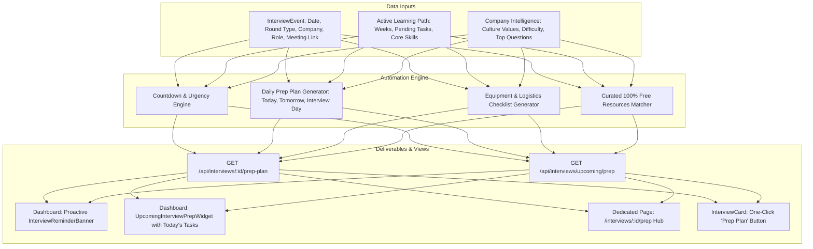

# Feature 3: Interview Reminder & Prep Automation

## Overview
The **Interview Reminder & Prep Automation** system connects Career Copilot's:
1. **Interview Tracker with Calendar** (`InterviewEvent`, schedules, rounds, deadlines)
2. **Personalized Learning Path** (skill gaps, weekly task roadmaps, curated resources)
3. **Company-Specific Interview Prep** (culture values, difficulty ratings, high-frequency question bank, insider tips)

It provides job seekers with a deterministic, zero-AI-budget, high-yield preparation roadmap tailored specifically to each upcoming interview round, accompanied by live countdown clocks, urgency tiering, interactive equipment/readiness checklists, and proactive dashboard reminder banners.

---

## Architecture & Integration Diagram



---

## 1. Urgency Levels & Countdown Engine

The engine computes countdown metrics dynamically relative to `interview.scheduledStart`:

| Hours Until Interview | Urgency Tier | Badge Variant | Primary Callout |
|---|---|---|---|
| **$\le$ 24 hours** | `critical` | `destructive` (pulse) | Critical Alert: Final hours readiness & logistics checks |
| **$\le$ 72 hours (3 days)** | `high` | `warning` | High Priority: Intensive topic review & mock simulation |
| **$\le$ 168 hours (7 days)** | `moderate` | `default` | Coming Up: Core patterns & company culture alignment |
| **> 168 hours** | `low` | `secondary` | Scheduled: Steady syllabus pacing from Learning Path |

### Human-Readable Formatting
- **Under 1 hour**: `X mins`
- **Under 24 hours**: `Xh Ym`
- **Over 24 hours**: `X days, Yh`
- **Past scheduled time**: `Concluded or In Progress`

---

## 2. Tailored Daily Prep Plans

Daily prep plans are generated deterministically based on round category:

### Technical Rounds (`TECHNICAL`)
- Review high-yield algorithmic patterns (Two Pointers, Sliding Window, BFS/DFS, Binary Search).
- Walk through a complex system design/scalability pattern aloud.
- Practice explaining Big-O space and time complexity before writing solution code.
- Defend resume bullets regarding technical trade-offs.

### Online Assessments (`OA`)
- Complete 2 timed LeetCode medium problems under strict 45-minute exam timer.
- Inspect edge cases: null/empty inputs, integer overflow, 1-element arrays, extreme bounds.
- Set up boilerplate I/O code and hotkeys.

### HR & Screening Rounds (`HR` / `SCREENING`)
- 60-second elevator pitch answering "Tell me about yourself" tailored to the company.
- STAR-format stories (Situation, Task, Action, Result) for Conflict, Leadership, and Impact.
- Research company mission, product launches, and engineering culture.

### Managerial Rounds (`MANAGERIAL`)
- Situational examples demonstrating cross-functional leadership, mentoring, and trade-offs.
- Post-mortems: handling project scope changes and missing deadlines.
- 3 strategic questions regarding engineering culture and team roadmap.

---

## 3. Interactive Equipment & Readiness Checklist

Persisted locally across page reloads via `localStorage`:
- **Audio & Video**: Test webcam, microphone, and speakers inside Zoom/Meet/Teams 30 min before start.
- **Network**: Verify stable Wi-Fi connection with mobile hotspot backup enabled on standby.
- **Lighting & Space**: Ensure clean, quiet room with optimal front lighting and zero background distractions.
- **Documents**: Have resume copy, portfolio, and target job description open for instant reference.
- **Scratch Notes**: Keep physical notepad and pen ready for sketching diagrams and algorithms.
- **Company Values**: Review core principles (e.g. Googleyness, Customer Obsession) to cite in responses.
- **Reverse Questions**: Prepare 3-5 thoughtful reverse questions to ask the interviewer.
- **Mindset & Calm**: Hydrate, breathe deeply, and view the interview as a collaborative discussion.

---

## 4. API Endpoints Reference

### 1. `GET /api/interviews/:id/prep-plan`
Returns the tailored prep roadmap, company intel, questions, and checklist for a specific interview round.

**Response Structure:**
```json
{
  "success": true,
  "data": {
    "interviewId": "evt-123",
    "company": "Google",
    "role": "Senior Backend Engineer",
    "roundTitle": "Round 2: System Architecture",
    "roundType": "TECHNICAL",
    "mode": "ONLINE",
    "scheduledStart": "2026-10-15T15:30:00.000Z",
    "durationMin": 60,
    "meetingLink": "https://meet.google.com/abc-defg-hij",
    "timeUntil": "2 days, 4h",
    "hoursUntil": 52,
    "urgencyLevel": "high",
    "prepPlan": {
      "today": [
        "Review top 5 coding patterns: Two Pointers, Sliding Window, BFS/DFS, Binary Search for Google",
        "Walk through 1 complex system design / scalability pattern aloud",
        "Review your resume bullet points for Senior Backend Engineer stack and be ready to defend technical trade-offs"
      ],
      "tomorrow": [
        "Conduct 1 full 45-minute timed mock interview simulating Google questions",
        "Re-read Google's core culture values and align your talking points with them"
      ],
      "interviewDay": [
        "Warm up with 1 easy coding problem to get into problem-solving flow",
        "Sanity check room lighting, camera angle, microphone audio, and meeting link 30 minutes prior"
      ]
    },
    "checklist": [
      {
        "id": "chk-audio-video",
        "category": "logistics",
        "text": "Test webcam, microphone, and headphones inside the meeting app 30 min before start"
      }
    ],
    "resources": [
      {
        "id": "res-dsa-0",
        "title": "Algorithms & Data Structures Free Crash Course",
        "url": "https://www.freecodecamp.org/news/data-structures-and-algorithms-in-python-free-crash-course/",
        "type": "COURSE",
        "durationMinutes": 60,
        "source": "freeCodeCamp",
        "isFree": true
      }
    ],
    "companyIntel": {
      "name": "Google",
      "difficulty": "Hard",
      "averageRounds": 5,
      "cultureSummary": "Innovation-driven, consensus-building, data-focused, fast-paced...",
      "keyValues": ["Focus on the user", "Think 10x", "Intellectual Humility", "Googleyness"],
      "topQuestions": [ ... ]
    },
    "reverseQuestionsToAsk": [
      "What does success look like for someone in this role within the first 90 days?",
      "How does your engineering team manage technical debt and architectural refactoring alongside new feature delivery?"
    ]
  }
}
```

### 2. `GET /api/interviews/upcoming/prep?limit=5&days=14`
Returns upcoming scheduled rounds with urgency levels, countdowns, and top tasks for today's sprint.

---

## 5. UI Components

1. **`InterviewReminderBanner.tsx`** (`src/components/dashboard/InterviewReminderBanner.tsx`)
   - Proactive alert displayed when an interview is scheduled in $\le$ 72 hours.
   - Shows countdown, company, round, and top task for today with a 1-click "Open Prep Plan" button.
2. **`UpcomingInterviewPrepWidget.tsx`** (`src/components/dashboard/UpcomingInterviewPrepWidget.tsx`)
   - Dashboard card rendering the next interview countdown and an interactive "Today's Recommended Prep Tasks" checklist with checkboxes.
3. **`InterviewPrepPage.tsx`** (`src/app/interviews/[id]/prep/page.tsx`)
   - Full dedicated preparation hub:
     - Header with countdown timer and "Join Video Meeting" shortcut
     - Daily prep plan tabs ("Today's Focus", "Leading Up", "Interview Day")
     - Interactive equipment & readiness checklist with progress bar
     - Company intelligence, culture values, and top interview questions with expandable solutions
     - Curated 100% free learning resources & reverse questions for interviewer
     - Connected active Learning Path tasks
4. **`InterviewCard.tsx`** (`src/components/interviews/InterviewCard.tsx`)
   - Added direct "Prep Plan" button to every interview round card.
5. **`UpcomingInterviewsWidget.tsx`** (`src/components/dashboard/UpcomingInterviewsWidget.tsx`)
   - Added direct "Prep" icon shortcut to each listed round.

---

## 6. Verification & Test Suite

Run unit tests via:
```bash
npm test
```

Test files:
- `tests/interviewPrep/generator.test.ts` (12 tests)
- `tests/interviewPrep/queries.test.ts` (4 tests)
- `tests/calendar/interviewIcs.test.ts` (2 tests)
- `tests/calendar/tokenService.test.ts` (2 tests)
- `tests/interviews/queries.test.ts` (1 test)
- `tests/learningPath/generator.test.ts` (5 tests)
- `tests/learningPath/prioritizer.test.ts` (3 tests)
- `tests/learningPath/queries.test.ts` (2 tests)

**Total: 8 test suites, 31 tests passing (100% success rate).**
